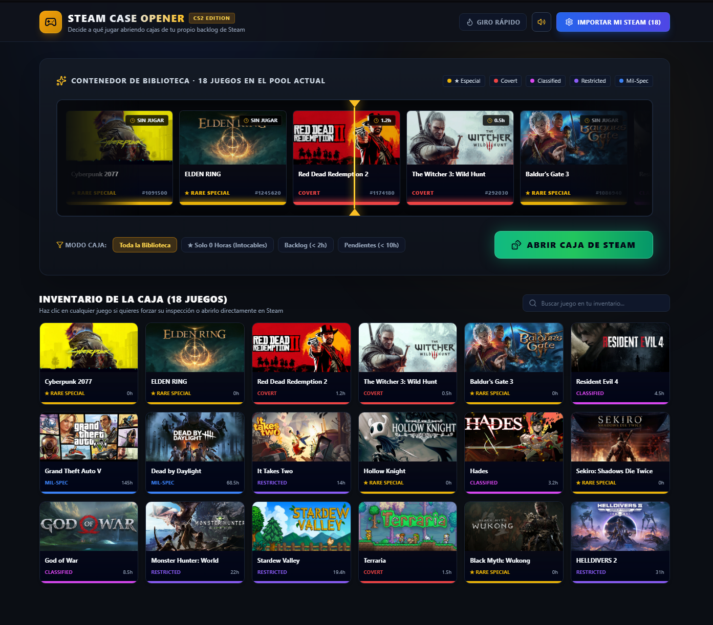

# 🎰 Steam Case Opener

Aplicación web interactiva inspirada en la apertura de cajas de **Counter-Strike 2 (CS:GO / CS2)** para elegir al azar a qué juego de tu biblioteca de **Steam** jugar cuando tienes un *backlog* infinito y no sabes por cuál decidirte.

Hecha con **React + Vite + Tailwind CSS**.

## 🔗 Demo en vivo

👉 [Ver Steam Case Opener desplegado](https://steam-case-opener.vercel.app)

## 📸 Capturas

## ✨ Funcionalidades

- **Cinta de apertura estilo CS2:** Animación horizontal de alta velocidad con desaceleración realista (`cubic-bezier`) y aterrizaje milimétrico aleatorio dentro de la tarjeta.
- **Audio Sintetizado (Web Audio API):** Efectos de sonido mecánicos (*ticks*) generados en tiempo real al cruzar la aguja central y melodías de victoria según la rareza obtenida, sin archivos de audio externos.
- **Sistema de rarezas automático según tu Backlog:**
  - 🟨 **★ Especial (Dorado):** Juegos con 0 horas jugadas (intocables).
  - 🟥 **Covert (Rojo):** Menos de 2 horas.
  - 🟪 **Classified (Rosa):** Entre 2h y 10h.
  - 🟪 **Restricted (Morado):** Entre 10h y 40h.
  - 🟦 **Mil-Spec (Azul):** Veteranos con más de 40h.
- **Conexión con Steam (`steam://run/<appid>`):** Botón directo para lanzar o instalar el juego ganador en tu cliente de Steam de escritorio.
- **Importación flexible:** Conexión directa mediante Steam Web API (con proxy local en Vite para evitar CORS), importación mediante copia de JSON o adición manual de juegos.

## 🛠️ Tecnologías

- **React 18**
- **Vite**
- **Tailwind CSS**
- **Lucide React** (Iconografía)
- **Steam Web API + Web Audio API**

## 🚀 Cómo ejecutarlo en local

# Clona el repositorio
git clone https://github.com/Camilx03/steam-case-opener.git
cd steam-case-opener

# Instala las dependencias
npm install

# Arranca el servidor de desarrollo
npm run dev